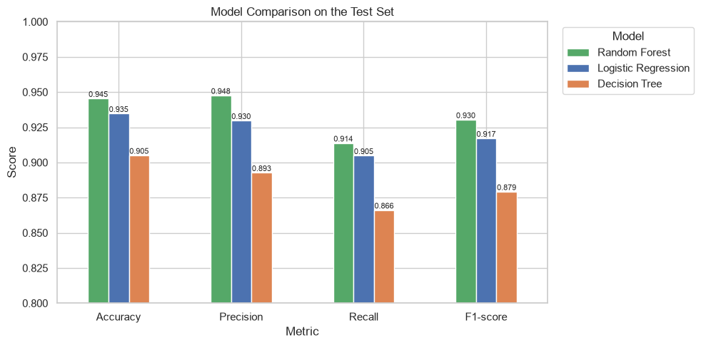
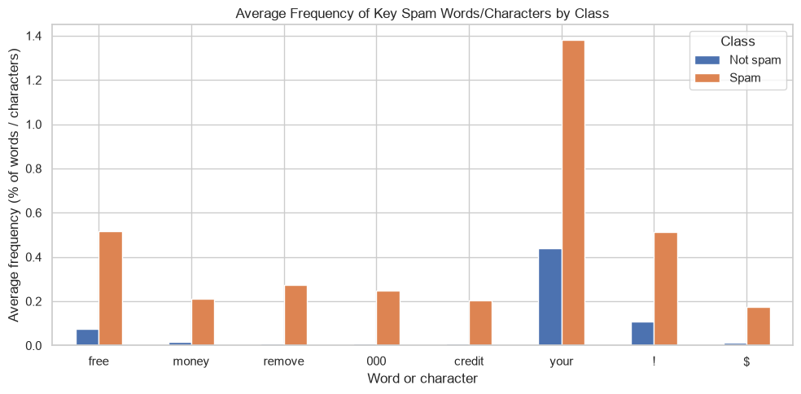
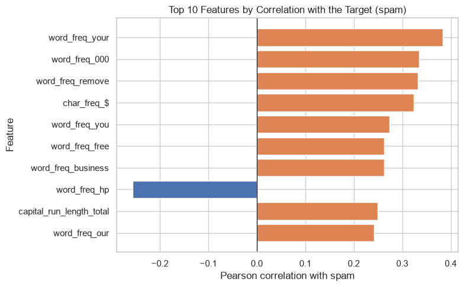
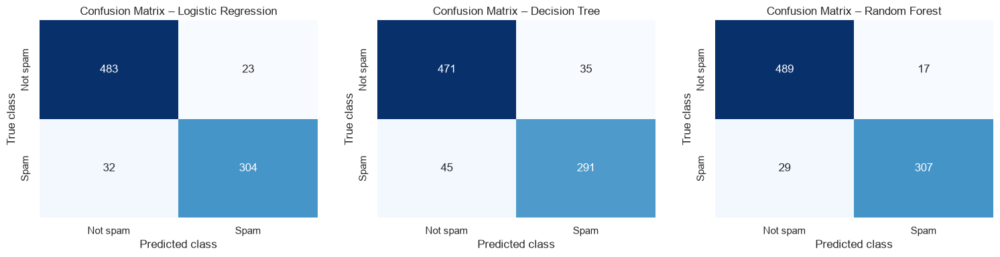
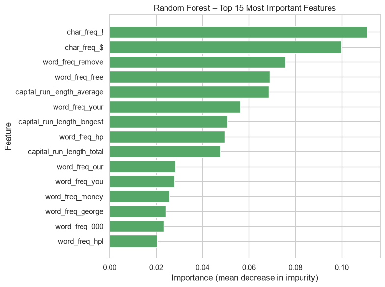
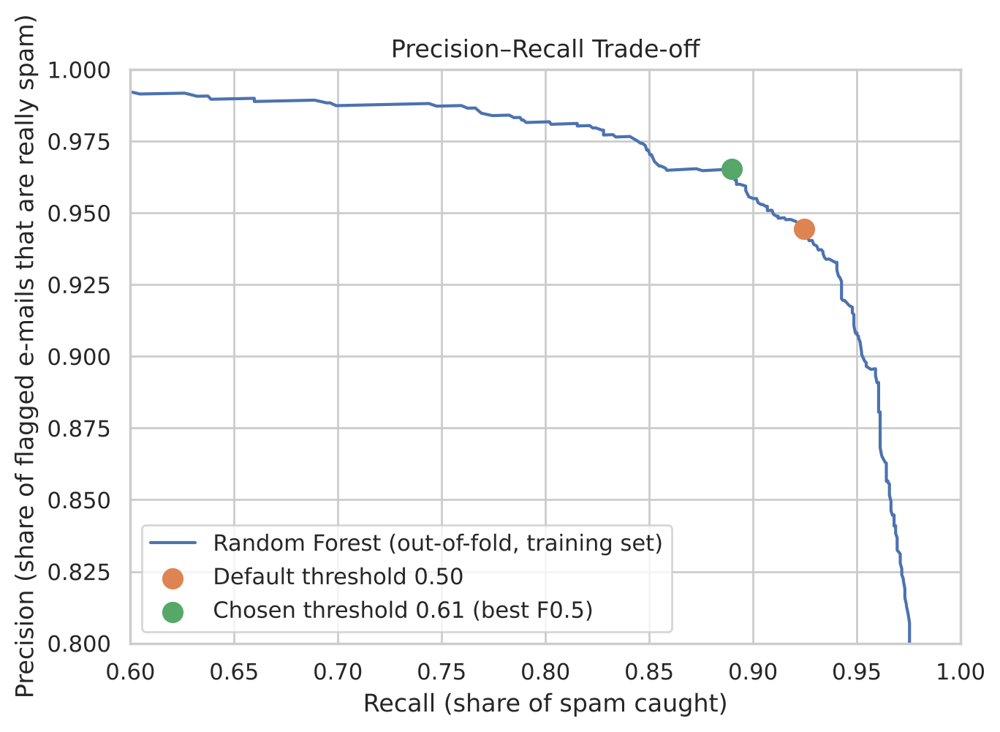
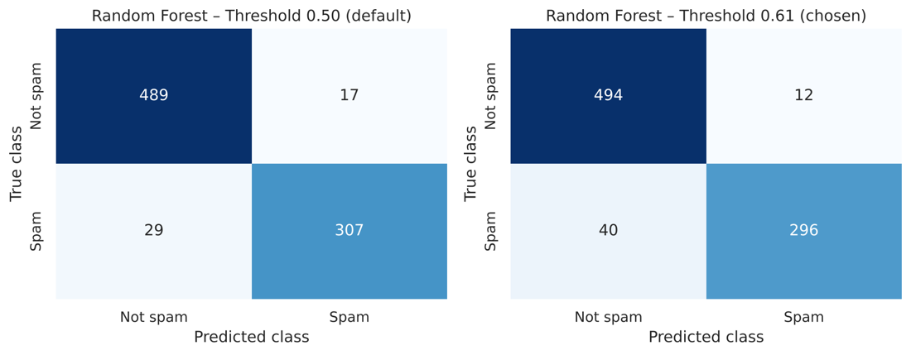

# 📧 Spam Email Classification — Spambase

> تصنيف رسائل البريد الإلكتروني إلى سبام أو غير سبام باستخدام تعلم الآلة، ومقارنة ثلاثة نماذج.

A machine learning project that classifies emails as **spam** or **not spam** using the
[UCI Spambase dataset](https://archive.ics.uci.edu/dataset/94/spambase). It trains three models
(Logistic Regression, Decision Tree and Random Forest) and compares them.

**Main result:** Random Forest performed best, with **94.5% accuracy** and **F1 = 0.930** on the test set.
Raising its decision threshold from 0.5 to 0.61 then cut real emails wrongly marked as spam from **17 to 12 (−29%)**.



---

## 🎯 Problem

Spam wastes time and often carries scams or harmful links. This is a **binary classification** problem:
given 57 features of an email, predict whether it is spam (`1`) or not spam (`0`).

## 📊 Dataset

| Item | Value |
|---|---|
| Source | [UCI Machine Learning Repository: Spambase](https://archive.ics.uci.edu/dataset/94/spambase) |
| Emails | 4,601 (4,210 after removing 391 duplicates) |
| Features | 57 numeric features |
| Target | `spam` (1 = spam, 0 = not spam) |
| Class balance | ~60% not spam / ~40% spam |
| Missing values | None |

**Feature groups:**
- **48 `word_freq_*`:** percentage of words in the email that match a given word (e.g. `free`, `money`, `remove`)
- **6 `char_freq_*`:** percentage of characters that are `;` `(` `[` `!` `$` `#`
- **3 `capital_run_length_*`:** average, longest and total length of runs of capital letters

## 🛠️ Workflow

1. **Understand the problem:** dataset, features, target and goal
2. **Explore the data:** shape, missing values, duplicates, class counts and 4 charts
3. **Prepare the data:**
   - Check for missing values (none) and text columns (none)
   - Remove 391 duplicate rows to avoid data leakage between train and test
   - 80/20 stratified train/test split (`random_state=42`)
   - `StandardScaler` fitted on the training set only (used for Logistic Regression)
4. **Train the models:**
   - Logistic Regression (scaled features)
   - Decision Tree, tuned with `GridSearchCV` (best: `max_depth=10`)
   - Random Forest (300 trees)
   - 5-fold stratified cross-validation on the training set for each model
5. **Evaluate and compare:** accuracy, precision, recall, F1-score and confusion matrices on the test set
6. **Explain the findings:** best model, feature importance, limitations and one improvement
7. **Implement the improvement:** tune the Random Forest and choose a better decision threshold (added after the course)

## 🔍 Exploring the Data

| Key spam words by class | Strongest correlations with spam |
|---|---|
|  |  |

Spam emails use more `!` and `$`, words like `free`, `remove` and `money`, and more CAPITAL letters.

## 📈 Results (test set: 842 emails)

| Model | Accuracy | Precision | Recall | F1-score | False positives | CV F1 |
|---|---|---|---|---|---|---|
| **Random Forest** | **0.945** | **0.948** | **0.914** | **0.930** | **17** | **0.935** |
| Logistic Regression | 0.935 | 0.930 | 0.905 | 0.917 | 23 | 0.897 |
| Decision Tree | 0.905 | 0.893 | 0.866 | 0.879 | 35 | 0.888 |



**Best model: Random Forest.** It was best on every metric and had the fewest false positives,
so it wrongly blocks the fewest real emails. It combines 300 trees, which cancels out many of the
mistakes a single tree makes, and it can capture non-linear patterns between features.
The cross-validation scores show the same ranking, so the result isn't just a lucky test split.

> In spam filtering, **precision** matters a lot: a false positive means a real email ends up in the spam folder.

### Most important features



`!`, `$`, `remove`, `free`, `your` and the capital-letter features point towards spam.
`hp` and `george` point towards not spam.

## ⚠️ Limitations

- The emails are from 1999 and come from one company (HP Labs), so some features such as `george` and `hp` are specific to that mailbox.
- The bag-of-words features lose word order and meaning, and the raw text isn't available to add new features.
- 3 pairs of emails have identical features but opposite labels.
- Tuning the Random Forest's settings did not improve it, so the remaining mistakes come from the data, not the settings.

## 💡 Improvement: Fewer Real Emails in the Spam Folder

Added after the course submission (Step 7 in the notebook). The goal was to reduce **false positives**,
because losing a real email is worse than seeing one more spam.

1. **Tuning the Random Forest** with `GridSearchCV` (16 combinations × 5-fold CV) found that the default
   settings were already the best (CV F1 = 0.935). Tuning alone didn't help.
2. **Choosing a new decision threshold:** out-of-fold probabilities on the **training set** gave a
   precision–recall curve, and the threshold with the best **F0.5-score** (precision counts twice as much
   as recall) was **0.61**. The test set was not used for this choice, so the result below is an honest estimate.



| Random Forest | Precision | Recall | F1-score | False positives | False negatives |
|---|---|---|---|---|---|
| Threshold 0.50 (default) | 0.948 | 0.914 | 0.930 | 17 | 29 |
| **Threshold 0.61 (chosen)** | **0.961** | 0.881 | 0.919 | **12** | 40 |



**Trade-off:** 5 more real emails reach the inbox, while 11 more spam emails get through.
The right threshold depends on what each mistake costs. A next step would be trying gradient boosting
(e.g. `HistGradientBoostingClassifier`).

## 📁 Repository Structure

```
├── Spambase_Classification.ipynb   # Notebook: code, charts and results
├── spambase.data                   # Dataset (UCI Spambase, CC BY 4.0)
├── docs/
│   ├── Spambase_Report.pdf         # Project report (6 pages)
│   └── Spambase_Presentation.pptx  # Presentation slides
├── images/                         # Charts used in this README
├── requirements.txt
└── README.md
```

## ▶️ How to Run

1. Clone the repository and install the libraries:

   ```bash
   git clone https://github.com/nora2164/Machine-Learning-project.git
   cd Machine-Learning-project
   pip install -r requirements.txt
   ```

2. Open the notebook (the dataset `spambase.data` is already included):

   ```bash
   jupyter notebook Spambase_Classification.ipynb
   ```

> You can also just read the notebook on GitHub: all outputs and charts are saved in it.
> Running all cells takes about 2 minutes (most of it is the grid search in Step 7).

## 🧰 Tools

Python · pandas · Matplotlib · Seaborn · scikit-learn · Jupyter Notebook

## 👩‍💻 Author

**Nora Al-Qahtani**: Computer Science student, Prince Sattam bin Abdulaziz University ([@nora2164](https://github.com/nora2164))
Machine Learning course project.

## 📚 Reference

Hopkins, M., Reeber, E., Forman, G., & Suermondt, J. (1999). *Spambase* [Dataset].
UCI Machine Learning Repository. https://doi.org/10.24432/C53G6X
